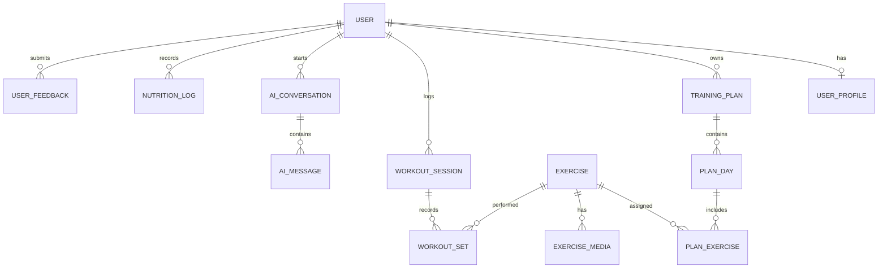

# ZYVON AI — Initial Data Model (ERD)

This is the logical MVP model. Exact Prisma types, indexes, and migrations will be implemented during the database phase.

## Entity relationships

## Tables

### User
- id (UUID, primary key)
- email (unique, nullable when using another identity provider)
- passwordHash (nullable for external identity)
- role (USER | ADMIN)
- status (ACTIVE | SUSPENDED)
- createdAt, updatedAt

### UserProfile
- id, userId (unique FK)
- displayName
- birthDate (optional)
- heightCm (optional)
- weightKg (optional)
- preferredLanguage (ar | en)
- goal (FAT_LOSS | MUSCLE_GAIN | STRENGTH | ENDURANCE | MOBILITY | GENERAL)
- experienceLevel (BEGINNER | INTERMEDIATE | ADVANCED)
- trainingDaysPerWeek
- sessionMinutes
- equipment (JSON)
- safetyNotes (optional; private and access-controlled)
- createdAt, updatedAt

### TrainingPlan
- id, userId (FK)
- title, goal
- status (DRAFT | ACTIVE | COMPLETED | ARCHIVED)
- startDate, endDate (optional)
- createdAt, updatedAt

### PlanDay
- id, trainingPlanId (FK)
- dayNumber
- title
- notes (optional)

### Exercise
- id
- slug (unique)
- nameAr, nameEn
- descriptionAr, descriptionEn
- instructionsAr, instructionsEn
- primaryMuscles (JSON)
- equipment (JSON)
- difficulty
- safetyNotesAr, safetyNotesEn
- status (DRAFT | PUBLISHED | ARCHIVED)
- createdAt, updatedAt

### ExerciseMedia
- id, exerciseId (FK)
- type (IMAGE | VIDEO | AUDIO)
- url
- language (ar | en | neutral)
- sortOrder
- altTextAr, altTextEn

### PlanExercise
- id, planDayId (FK), exerciseId (FK)
- sortOrder
- sets, repsMin, repsMax
- durationSeconds (optional)
- restSeconds
- notes

### WorkoutSession
- id, userId (FK), trainingPlanId (optional FK)
- startedAt, completedAt (optional)
- status (IN_PROGRESS | COMPLETED | ABANDONED)
- perceivedEffort (optional 1–10)
- feedback (optional)

### WorkoutSet
- id, workoutSessionId (FK), exerciseId (FK)
- setNumber
- reps (optional)
- loadKg (optional)
- durationSeconds (optional)
- completed

### AIConversation
- id, userId (FK)
- channel (TEXT | VOICE)
- createdAt, updatedAt

### AIMessage
- id, conversationId (FK)
- role (USER | ASSISTANT | SYSTEM)
- content
- safetyStatus (PENDING | PASSED | FLAGGED)
- createdAt

### NutritionLog
- id, userId (FK)
- loggedAt
- calories (optional)
- proteinGrams (optional)
- carbsGrams (optional)
- fatGrams (optional)
- notes (optional)

### UserFeedback
- id, userId (FK)
- category
- rating (1–5)
- comment (optional)
- createdAt

## Data rules
- All private records are scoped by userId through server-side authorization.
- Store password hashes only; never store plaintext passwords.
- Admin privileges are enforced by the API, not by hiding UI controls.
- Use UTC timestamps in storage and localize them in clients.
- Treat safetyNotes and user-reported discomfort as private data.
- Validate numeric values and enum values at API boundaries.
- Add indexes for userId, createdAt, status, and foreign keys as query patterns are implemented.

## Open implementation decisions
- Authentication provider and session strategy.
- Data retention and account deletion workflow.
- Media storage provider and signed URL strategy.
- Whether nutrition tracking is enabled in the first public beta.
